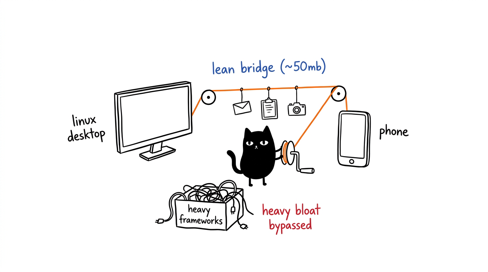

# Caelestia Connect

A standalone KDE Connect client written from scratch in Python and GTK4 / Libadwaita. It communicates with the official KDE Connect Android app and requires no KDE or Qt runtime libraries.

Originally created for the [Caelestia shell](https://github.com/caelestia-dots/shell), this fork adapts Caelestia Connect for standalone use across Linux desktop environments (KDE Plasma, GNOME, Hyprland, Sway, and Waybar) with native file manager integration, connection stability improvements, and expanded screen mirroring controls.



## Fork improvements

- **Memory and connection stability:** Resolves an upstream issue where unclosed `Gio.TlsClientConnection` streams and reconnect loops against local interface addresses caused background memory to grow over time. The daemon now filters out own-host addresses, explicitly closes failed TLS streams, and applies exponential reconnect backoff (0.5s to 60s). Idle memory stays around 50 MB.
- **Multi-network deduplication:** If a paired phone is reachable over both local Wi-Fi and a VPN interface (such as Tailscale), the daemon keeps a single active link rather than initiating competing handshakes.
- **Dolphin file manager integration:** Installs a Dolphin KIO service menu ("Share via Celestia…") using `caelestia-share`. When multiple paired devices are reachable, it prompts with a `kdialog` selection list; with a single device, it sends immediately.
- **Screen mirroring controls (scrcpy):**
  - Toggle the physical phone screen off and on (`Alt+O` / `Alt+Shift+O`) while keeping mouse, keyboard, and touch controls active.
  - Configurable resolution limits, frame rate presets (up to 120 fps), video bit rates (4–32 Mbps), virtual display mode, and audio forwarding toggles.
  - Support for passing custom scrcpy arguments.
- **Desktop integration:** Includes a StatusNotifierItem (SNI) D-Bus tray implementation for KDE Plasma, GNOME (via AppIndicator), and Waybar, and installs bundled `Google Sans Flex` and `Material Symbols Rounded` fonts into `~/.local/share/fonts/caelestia`.

## Features

- Discovery over UDP broadcast and mDNS, with encrypted TLS connections over Wi-Fi, Ethernet, or Bluetooth RFCOMM
- Pairing with verification key
- Battery and cellular signal status
- Bi-directional notification sync with actions, inline replies, and dismissal
- Send files, folders, links, and text in both directions
- Shared clipboard via `wl-clipboard`
- Bi-directional MPRIS media controls
- SMS and MMS conversation history with contact names and direct replies
- Incoming call notifications, muting, and media pause during calls
- Ring device (ring phone from computer, or ring computer from phone)
- Bluetooth audio output routing via PipeWire
- Phone as touchpad and keyboard, and remote control for the phone
- Mouse and keyboard edge sharing past screen borders (`uinput`)
- Remote command execution
- Screen mirroring and phone camera preview via `scrcpy`
- Virtual webcam via `v4l2loopback` (`Caelestia Phone Camera`)
- Browse phone storage via SFTP / SSHFS
- Virtual monitor between computers
- File manager sharing for KDE Dolphin and GNOME Files (Nautilus)
- StatusNotifierItem tray icon for KDE Plasma, GNOME, and Waybar
- Status bar widget for Caelestia shell

## Installation

### Dependencies

On Debian / Ubuntu:

```sh
sudo apt update
sudo apt install -y \
  python3-gi gir1.2-gtk-4.0 gir1.2-adw-1 python3-evdev python3-cryptography \
  wl-clipboard pulseaudio-utils sshfs scrcpy adb kdialog
```

On Arch Linux:

```sh
sudo pacman -S --needed \
  python-gobject libadwaita python-cryptography python-evdev \
  wl-clipboard libpulse sshfs scrcpy android-tools android-udev kdialog
```

Optional dependencies:
- Virtual monitor between computers: `wayvnc` (host) and `freerdp` (client).
- Presentation pointer overlay: `gtk4-layer-shell`.

### Install

```sh
git clone https://github.com/1999AZZAR/caelestia-connect.git
cd caelestia-connect
./install.sh
```

`install.sh` handles setup for the current user:
1. Installs `caelestia-connect`, `caelestia-connectd`, `caelestia-connect-cli`, and `caelestia-share` into `~/.local/bin`.
2. Installs the desktop launcher, application icon, Dolphin KIO service menu, and Nautilus Python extension.
3. Copies bundled fonts to `~/.local/share/fonts/caelestia` and refreshes the font cache.
4. Enables and starts the `caelestia-connectd.service` user unit.
5. If Caelestia shell is present, patches status icons and bar popouts (use `--no-shell` to skip).

To uninstall:
```sh
./install.sh --uninstall
```
Pairing data and configuration in `~/.config/caelestia-connect` are retained.

### Experimental Rust daemon

The Rust backend uses the existing Python GTK interface. It supports IPv4 discovery, pairing, file transfers, link and text sharing, battery and mobile signal status, Ping, Ring device, manual clipboard sharing, media and system volume controls, Bluetooth audio routing, SMS/MMS and contacts, notifications from the phone, call alerts and media pause, and screensaver inhibition. You can run the Rust preview with a separate profile alongside the regular app. The backend guide lists the features still available through the Python daemon. [Rust backend guide](rust-daemon/README.md)

### Firewall

KDE Connect discovery and data transfer use UDP and TCP ports `1714` to `1764`:

```sh
sudo ufw allow 1714:1764/udp && sudo ufw allow 1714:1764/tcp
```

### Remote input permissions (`uinput`)

Controlling the computer's mouse and keyboard from the phone requires write access to `/dev/uinput`:

```sh
echo 'KERNEL=="uinput", GROUP="input", MODE="0660", TAG+="uaccess"' | sudo tee /etc/udev/rules.d/60-uinput.rules
sudo udevadm control --reload-rules && sudo udevadm trigger
```

## Screen mirroring and phone camera

Screen mirroring and the camera preview run via [scrcpy](https://github.com/Genymobile/scrcpy) over Android debugging (ADB):

- **USB:** Enable *USB debugging* in Developer Options on the phone, plug in a USB cable, and approve the host prompt.
- **Wi-Fi:** Enable *Wireless debugging* on the phone and pair once with `adb pair <ip>:<port>`. The daemon matches connected ADB devices by IP address or device name.

### Mirroring controls

While mirroring:
- `Alt + O`: Toggle the phone screen off or on. The phone display goes dark to save power and reduce heat, while mouse, keyboard, and touchscreen input from the computer continue to work.
- `Alt + Shift + O`: Turn the phone screen back on.
- `Ctrl + F`: Fullscreen toggle.
- `Ctrl + G`: Resize window to 1:1 pixel scale.
- `Ctrl + H`: Home button.
- `Ctrl + B`: Back button.
- `Ctrl + S`: App switcher.

Settings under **Device Settings → Screen Mirroring (scrcpy)** configure resolution limits, maximum frame rates (30 to 120 fps), video bit rates (4 to 32 Mbps), audio forwarding, virtual display mode, and custom flags.

### Virtual webcam setup

To use the phone camera as a system webcam in browsers, OBS, or video call apps:

```sh
# On Arch Linux:
sudo pacman -S --needed v4l2loopback-dkms linux-headers ffmpeg v4l-utils
./install.sh --webcam

# On Debian / Ubuntu:
sudo apt install -y v4l2loopback-dkms linux-headers-generic ffmpeg v4l-utils
./install.sh --webcam
```

This sets up a loopback device named `Caelestia Phone Camera`. The camera starts streaming when an application opens the video device and stops when the application closes it.

## File sharing

- **KDE Dolphin:** Right-click any selection of files and choose **Share via Celestia…**. If one paired device is online, files are sent immediately. If multiple devices are available, a `kdialog` prompt asks which device to send to.
- **GNOME Files (Nautilus):** Right-click files and select **Send via Caelestia Connect**.

## Command line interface (CLI)

`caelestia-connect-cli` communicates with the background daemon over its local IPC socket:

```sh
caelestia-connect-cli list
caelestia-connect-cli ping "hello"
caelestia-connect-cli share photo.jpg https://example.com
caelestia-connect-cli send-clipboard
caelestia-connect-cli sms +15551234567 "message"
caelestia-connect-cli media PlayPause
caelestia-connect-cli ring
caelestia-connect-cli call <plugin> <action> '<json args>'
caelestia-connect-cli watch
```

## Architecture

```
caelestia_connect/
  daemon.py, api.py     Background service and JSON-RPC IPC over UNIX domain socket
  lan.py                Network discovery, TLS links, link deduplication, and backoff
  mdns.py               mDNS responder and browser
  bluetooth.py          BlueZ RFCOMM links with KDE Connect packet multiplexing
  device.py             Pairing state, packet dispatch, and plugin routing
  desktop/              System integrations (tray, notifications, audio, MPRIS, uinput, webcam)
    tray.py             StatusNotifierItem (SNI) D-Bus implementation
    android.py          scrcpy process management, display power, and camera loopback
  plugins/              Plugin implementations (share, mpris, sftp, sms, etc.)
  ui/                   GTK4 / Libadwaita client application
    device_settings.py  Per-device configuration and scrcpy mirroring settings
    mirroring.py        scrcpy launcher and session handling
  cli.py                CLI client
data/
  kio/                  Dolphin KIO service menu and caelestia-share helper
  nautilus/             Nautilus Python extension
  caelestia-connectd.service  Systemd user service unit
tests/                  Automated test suite with fake peer and network simulations
```

## Testing

```sh
python3 -m pytest tests/

# Test specific components
python3 -m pytest tests/test_lan_reconnect.py
python3 -m pytest tests/test_android.py

# Linting
ruff check .
ruff format --check .

# Run demo mode (simulates a connected phone without hardware)
python3 tests/demo.py
```

## Credits

- [maylton/caelestia-connect](https://github.com/maylton/caelestia-connect): Original client and daemon implementation.
- [ProSahil (@KingSahil)](https://github.com/KingSahil): Initial scrcpy screen mirroring and phone camera integration.
- [KDE Connect](https://invent.kde.org/network/kdeconnect-kde): Protocol specification and ecosystem.
- [scrcpy](https://github.com/Genymobile/scrcpy): Android screen mirroring and video streaming.
- Fork maintenance and enhancements by [1999AZZAR](https://github.com/1999AZZAR).

## License

GPL-3.0-or-later
